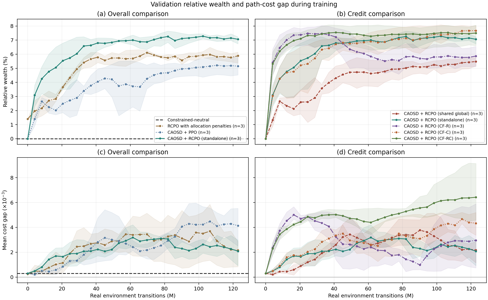

# V4.1 Paper Tables (best_feasible, seeds 0–2)

All test results use the same 100 held-out markets and the common drawdown rule.
Intervals resample the available training seeds and holdout anchors. Single-seed results reflect market uncertainty.

## Table 1. Overall Out-of-Sample Performance

| Method | Relative wealth (%) [95% CI] | Actual cumulative return (%) [95% CI] | Mean cost gap (×10⁻³) [95% CI] | Path feasibility (%) | MDD (%) | Turnover (%) | Allocation violation steps (%) |
| --- | ---: | ---: | ---: | ---: | ---: | ---: | ---: |
| Constrained-neutral | +0.00 [+0.00, +0.00] | 8.30 [5.82, 10.74] | +0.63 [+0.55, +0.69] | 15.00 | 15.69 | 0.00 | 0.00 |
| RCPO with allocation penalties | +6.87 [+5.28, +8.54] | 15.82 [12.43, 18.93] | +3.28 [+2.37, +4.44] | 33.00 | 15.77 | 6.70 | 29.88 |
| CAOSD + PPO | +6.99 [+5.15, +8.53] | 15.88 [11.50, 20.08] | +4.98 [+3.47, +6.49] | 31.67 | 15.88 | 3.26 | 0.00 |
| CAOSD + RCPO (shared global) | +2.81 [+1.82, +3.78] | 11.40 [8.36, 14.42] | +0.94 [+0.60, +1.21] | 38.00 | 15.37 | 2.02 | 0.00 |
| CAOSD + RCPO (standalone) | +3.09 [+2.01, +4.41] | 11.71 [8.72, 14.65] | +1.01 [+0.74, +1.31] | 38.33 | 15.46 | 1.22 | 0.00 |
| CAOSD + RCPO (CF-R) | +5.31 [+3.81, +6.91] | 13.98 [11.07, 16.63] | +1.70 [+0.57, +2.87] | 42.33 | 15.05 | 3.14 | 0.00 |
| CAOSD + RCPO (CF-C) | +3.04 [+2.00, +4.20] | 11.67 [8.72, 14.57] | +1.03 [+0.74, +1.37] | 39.00 | 15.46 | 1.32 | 0.00 |
| CAOSD + RCPO (CF-RC) | +3.90 [+2.90, +5.05] | 12.60 [9.73, 15.29] | +2.22 [+1.56, +3.11] | 33.33 | 15.89 | 1.20 | 0.00 |

## Table 2. Matched Credit Comparison Against Standalone

| Method | Δ relative wealth (pp) [95% CI] | Δ mean cost gap (×10⁻³) [95% CI] |
| --- | ---: | ---: |
| CAOSD + RCPO (shared global) | -0.28 [-0.92, +0.21] | -0.07 [-0.22, +0.09] |
| CAOSD + RCPO (standalone) | +0.00 [+0.00, +0.00] | +0.00 [+0.00, +0.00] |
| CAOSD + RCPO (CF-R) | +2.22 [+1.12, +3.49] | +0.69 [-0.55, +1.88] |
| CAOSD + RCPO (CF-C) | -0.05 [-0.29, +0.20] | +0.02 [-0.05, +0.12] |
| CAOSD + RCPO (CF-RC) | +0.81 [-0.65, +2.26] | +1.21 [+0.48, +2.12] |

## Table 3. Training and Deployment Costs

| Method | Training transitions (M) | Training hours | Peak RSS (GiB) | Decision latency (ms) | Relative time | Relative memory | Relative latency |
| --- | ---: | ---: | ---: | ---: | ---: | ---: | ---: |
| Constrained-neutral | 0.00 | N/A | N/A | 0.10 | N/A | N/A | 0.13 |
| RCPO with allocation penalties | 122.88 | 9.80 | 1.49 | 0.31 | 0.52 | 0.93 | 0.42 |
| CAOSD + PPO | 122.88 | 18.66 | 1.48 | 0.75 | 0.99 | 0.93 | 1.01 |
| CAOSD + RCPO (shared global) | 122.88 | 18.79 | 1.59 | 0.74 | 1.00 | 1.00 | 1.00 |
| CAOSD + RCPO (standalone) | 122.88 | 19.72 | 1.54 | 0.74 | 1.05 | 0.97 | 1.00 |
| CAOSD + RCPO (CF-R) | 122.88 | 28.13 | 1.97 | 0.83 | 1.50 | 1.24 | 1.12 |
| CAOSD + RCPO (CF-C) | 122.88 | 29.67 | 2.01 | 0.74 | 1.58 | 1.26 | 1.00 |
| CAOSD + RCPO (CF-RC) | 122.88 | 29.16 | 2.02 | 0.75 | 1.55 | 1.27 | 1.01 |

Training timing and memory ratios require matching hardware, timing boundaries, and interaction budgets.

## Figure 1. Validation Learning Curves

