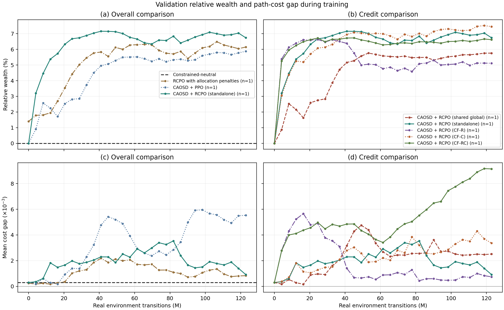

# V4.1 Paper Tables (best_feasible, seed 0)

All test results use the same 100 held-out markets and the common drawdown rule.
Intervals resample the available training seeds and holdout anchors. Single-seed results reflect market uncertainty.

## Table 1. Overall Out-of-Sample Performance

| Method | Relative wealth (%) [95% CI] | Actual cumulative return (%) [95% CI] | Mean cost gap (×10⁻³) [95% CI] | Path feasibility (%) | MDD (%) | Turnover (%) | Allocation violation steps (%) |
| --- | ---: | ---: | ---: | ---: | ---: | ---: | ---: |
| Constrained-neutral | +0.00 [+0.00, +0.00] | 8.30 [5.82, 10.74] | +0.63 [+0.55, +0.69] | 15.00 | 15.69 | 0.00 | 0.00 |
| RCPO with allocation penalties | +7.39 [+5.52, +9.25] | 16.41 [13.26, 19.18] | +3.27 [+2.29, +4.72] | 30.00 | 15.98 | 7.02 | 23.08 |
| CAOSD + PPO | +7.58 [+5.86, +8.92] | 16.46 [12.48, 20.13] | +4.86 [+3.57, +6.37] | 29.00 | 15.98 | 2.66 | 0.00 |
| CAOSD + RCPO (shared global) | +3.60 [+2.81, +4.21] | 12.23 [9.05, 15.33] | +1.14 [+1.04, +1.23] | 39.00 | 15.32 | 2.21 | 0.00 |
| CAOSD + RCPO (standalone) | +4.28 [+3.42, +5.03] | 13.06 [10.00, 15.92] | +1.16 [+0.93, +1.40] | 38.00 | 15.45 | 1.35 | 0.00 |
| CAOSD + RCPO (CF-R) | +5.52 [+4.19, +6.91] | 14.10 [10.94, 16.84] | +0.53 [+0.38, +0.74] | 56.00 | 14.06 | 5.47 | 0.00 |
| CAOSD + RCPO (CF-C) | +3.98 [+3.18, +4.67] | 12.73 [9.71, 15.57] | +1.12 [+0.91, +1.33] | 40.00 | 15.46 | 1.35 | 0.00 |
| CAOSD + RCPO (CF-RC) | +3.50 [+2.64, +4.08] | 12.19 [8.86, 15.33] | +1.58 [+1.26, +1.95] | 41.00 | 15.37 | 0.85 | 0.00 |

## Table 2. Matched Credit Comparison Against Standalone

| Method | Δ relative wealth (pp) [95% CI] | Δ mean cost gap (×10⁻³) [95% CI] |
| --- | ---: | ---: |
| CAOSD + RCPO (shared global) | -0.68 [-1.34, -0.03] | -0.02 [-0.22, +0.18] |
| CAOSD + RCPO (standalone) | +0.00 [+0.00, +0.00] | +0.00 [+0.00, +0.00] |
| CAOSD + RCPO (CF-R) | +1.24 [+0.60, +1.90] | -0.63 [-0.86, -0.47] |
| CAOSD + RCPO (CF-C) | -0.30 [-0.36, -0.23] | -0.04 [-0.09, -0.01] |
| CAOSD + RCPO (CF-RC) | -0.78 [-1.36, -0.24] | +0.42 [+0.08, +0.81] |

## Table 3. Training and Deployment Costs

| Method | Training transitions (M) | Training hours | Peak RSS (GiB) | Decision latency (ms) | Relative time | Relative memory | Relative latency |
| --- | ---: | ---: | ---: | ---: | ---: | ---: | ---: |
| Constrained-neutral | 0.00 | N/A | N/A | 0.10 | N/A | N/A | 0.13 |
| RCPO with allocation penalties | 122.88 | 9.81 | 1.49 | 0.26 | 0.52 | 0.94 | 0.35 |
| CAOSD + PPO | 122.88 | 18.78 | 1.48 | 0.73 | 1.00 | 0.93 | 0.99 |
| CAOSD + RCPO (shared global) | 122.88 | 18.79 | 1.59 | 0.74 | 1.00 | 1.00 | 1.00 |
| CAOSD + RCPO (standalone) | 122.88 | 19.14 | 1.53 | 0.75 | 1.02 | 0.96 | 1.01 |
| CAOSD + RCPO (CF-R) | 122.88 | 27.74 | 1.94 | 0.74 | 1.48 | 1.22 | 1.00 |
| CAOSD + RCPO (CF-C) | 122.88 | 29.48 | 2.01 | 0.74 | 1.57 | 1.27 | 1.00 |
| CAOSD + RCPO (CF-RC) | 122.88 | 30.10 | 2.03 | 0.73 | 1.60 | 1.27 | 0.99 |

Training timing and memory ratios require matching hardware, timing boundaries, and interaction budgets.

## Figure 1. Validation Learning Curves

