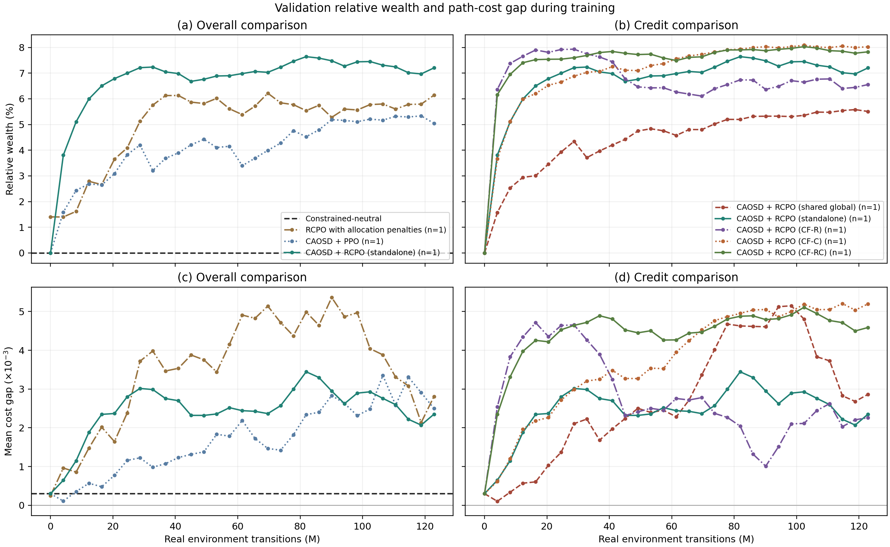

# V4.1 Paper Tables (best_feasible, seed 1)

All test results use the same 100 held-out markets and the common drawdown rule.
Intervals resample the available training seeds and holdout anchors. Single-seed results reflect market uncertainty.

## Table 1. Overall Out-of-Sample Performance

| Method | Relative wealth (%) [95% CI] | Actual cumulative return (%) [95% CI] | Mean cost gap (×10⁻³) [95% CI] | Path feasibility (%) | MDD (%) | Turnover (%) | Allocation violation steps (%) |
| --- | ---: | ---: | ---: | ---: | ---: | ---: | ---: |
| Constrained-neutral | +0.00 [+0.00, +0.00] | 8.30 [5.82, 10.74] | +0.63 [+0.55, +0.69] | 15.00 | 15.69 | 0.00 | 0.00 |
| RCPO with allocation penalties | +6.27 [+4.87, +7.53] | 15.27 [11.78, 18.55] | +3.13 [+2.35, +3.84] | 35.00 | 15.64 | 7.45 | 10.17 |
| CAOSD + PPO | +7.02 [+5.43, +8.52] | 15.90 [11.68, 20.00] | +3.63 [+3.08, +4.15] | 31.00 | 15.65 | 4.93 | 0.00 |
| CAOSD + RCPO (shared global) | +1.83 [+1.40, +2.17] | 10.31 [7.59, 12.92] | +0.58 [+0.48, +0.69] | 35.00 | 15.44 | 0.75 | 0.00 |
| CAOSD + RCPO (standalone) | +2.16 [+1.69, +2.66] | 10.67 [8.13, 13.15] | +0.77 [+0.65, +0.96] | 35.00 | 15.59 | 0.58 | 0.00 |
| CAOSD + RCPO (CF-R) | +4.41 [+3.18, +5.65] | 13.15 [10.62, 15.60] | +2.57 [+1.92, +3.66] | 30.00 | 16.09 | 1.19 | 0.00 |
| CAOSD + RCPO (CF-C) | +2.10 [+1.64, +2.59] | 10.61 [8.07, 13.08] | +0.75 [+0.64, +0.94] | 34.00 | 15.58 | 0.58 | 0.00 |
| CAOSD + RCPO (CF-RC) | +4.30 [+3.09, +5.50] | 13.03 [10.51, 15.47] | +2.51 [+1.89, +3.57] | 30.00 | 16.09 | 1.19 | 0.00 |

## Table 2. Matched Credit Comparison Against Standalone

| Method | Δ relative wealth (pp) [95% CI] | Δ mean cost gap (×10⁻³) [95% CI] |
| --- | ---: | ---: |
| CAOSD + RCPO (shared global) | -0.33 [-0.56, -0.12] | -0.19 [-0.29, -0.10] |
| CAOSD + RCPO (standalone) | +0.00 [+0.00, +0.00] | +0.00 [+0.00, +0.00] |
| CAOSD + RCPO (CF-R) | +2.25 [+1.49, +3.04] | +1.80 [+1.24, +2.72] |
| CAOSD + RCPO (CF-C) | -0.06 [-0.07, -0.05] | -0.02 [-0.02, -0.01] |
| CAOSD + RCPO (CF-RC) | +2.14 [+1.40, +2.91] | +1.74 [+1.21, +2.63] |

## Table 3. Training and Deployment Costs

| Method | Training transitions (M) | Training hours | Peak RSS (GiB) | Decision latency (ms) | Relative time | Relative memory | Relative latency |
| --- | ---: | ---: | ---: | ---: | ---: | ---: | ---: |
| Constrained-neutral | 0.00 | N/A | N/A | 0.10 | N/A | N/A | 0.13 |
| RCPO with allocation penalties | 122.88 | 9.86 | 1.49 | 0.29 | 0.52 | 0.93 | 0.39 |
| CAOSD + PPO | 122.88 | 18.55 | 1.49 | 0.76 | 0.97 | 0.93 | 1.03 |
| CAOSD + RCPO (shared global) | 122.88 | 19.14 | 1.59 | 0.74 | 1.00 | 1.00 | 1.00 |
| CAOSD + RCPO (standalone) | 122.88 | 18.94 | 1.53 | 0.73 | 0.99 | 0.96 | 0.99 |
| CAOSD + RCPO (CF-R) | 122.88 | 28.25 | 1.99 | 0.73 | 1.48 | 1.25 | 0.99 |
| CAOSD + RCPO (CF-C) | 122.88 | 29.77 | 2.01 | 0.74 | 1.56 | 1.26 | 1.00 |
| CAOSD + RCPO (CF-RC) | 122.88 | 28.94 | 2.03 | 0.77 | 1.51 | 1.27 | 1.04 |

Training timing and memory ratios require matching hardware, timing boundaries, and interaction budgets.

## Figure 1. Validation Learning Curves

