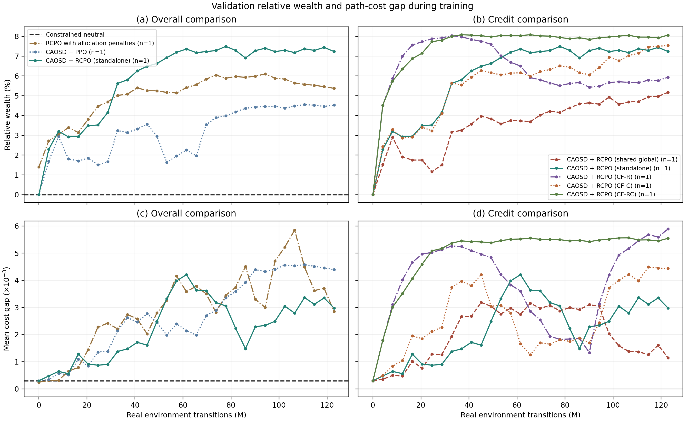

# V4.1 Paper Tables (best_feasible, seed 2)

All test results use the same 100 held-out markets and the common drawdown rule.
Intervals resample the available training seeds and holdout anchors. Single-seed results reflect market uncertainty.

## Table 1. Overall Out-of-Sample Performance

| Method | Relative wealth (%) [95% CI] | Actual cumulative return (%) [95% CI] | Mean cost gap (×10⁻³) [95% CI] | Path feasibility (%) | MDD (%) | Turnover (%) | Allocation violation steps (%) |
| --- | ---: | ---: | ---: | ---: | ---: | ---: | ---: |
| Constrained-neutral | +0.00 [+0.00, +0.00] | 8.30 [5.82, 10.74] | +0.63 [+0.55, +0.69] | 15.00 | 15.69 | 0.00 | 0.00 |
| RCPO with allocation penalties | +6.95 [+5.62, +8.10] | 15.78 [12.30, 18.95] | +3.43 [+2.19, +4.90] | 34.00 | 15.70 | 5.63 | 56.40 |
| CAOSD + PPO | +6.38 [+4.38, +8.37] | 15.29 [10.33, 20.25] | +6.45 [+5.83, +7.15] | 35.00 | 16.01 | 2.18 | 0.00 |
| CAOSD + RCPO (shared global) | +3.01 [+2.27, +3.62] | 11.65 [8.62, 14.53] | +1.09 [+0.87, +1.30] | 40.00 | 15.37 | 3.11 | 0.00 |
| CAOSD + RCPO (standalone) | +2.82 [+2.15, +3.56] | 11.41 [8.59, 14.15] | +1.10 [+0.81, +1.38] | 42.00 | 15.34 | 1.73 | 0.00 |
| CAOSD + RCPO (CF-R) | +6.01 [+4.34, +7.67] | 14.70 [11.77, 17.23] | +1.99 [+1.44, +2.47] | 41.00 | 15.01 | 2.77 | 0.00 |
| CAOSD + RCPO (CF-C) | +3.04 [+2.31, +3.77] | 11.66 [8.77, 14.46] | +1.23 [+0.93, +1.52] | 43.00 | 15.35 | 2.03 | 0.00 |
| CAOSD + RCPO (CF-RC) | +3.89 [+2.77, +5.02] | 12.60 [10.13, 14.99] | +2.58 [+2.01, +3.52] | 29.00 | 16.20 | 1.57 | 0.00 |

## Table 2. Matched Credit Comparison Against Standalone

| Method | Δ relative wealth (pp) [95% CI] | Δ mean cost gap (×10⁻³) [95% CI] |
| --- | ---: | ---: |
| CAOSD + RCPO (shared global) | +0.19 [-0.02, +0.43] | -0.01 [-0.10, +0.10] |
| CAOSD + RCPO (standalone) | +0.00 [+0.00, +0.00] | +0.00 [+0.00, +0.00] |
| CAOSD + RCPO (CF-R) | +3.18 [+2.15, +4.31] | +0.90 [+0.62, +1.18] |
| CAOSD + RCPO (CF-C) | +0.22 [+0.17, +0.27] | +0.13 [+0.09, +0.17] |
| CAOSD + RCPO (CF-RC) | +1.07 [+0.37, +1.86] | +1.48 [+0.96, +2.27] |

## Table 3. Training and Deployment Costs

| Method | Training transitions (M) | Training hours | Peak RSS (GiB) | Decision latency (ms) | Relative time | Relative memory | Relative latency |
| --- | ---: | ---: | ---: | ---: | ---: | ---: | ---: |
| Constrained-neutral | 0.00 | N/A | N/A | 0.10 | N/A | N/A | 0.13 |
| RCPO with allocation penalties | 122.88 | 9.71 | 1.48 | 0.38 | 0.53 | 0.93 | 0.50 |
| CAOSD + PPO | 122.88 | 18.65 | 1.48 | 0.74 | 1.01 | 0.93 | 1.00 |
| CAOSD + RCPO (shared global) | 122.88 | 18.45 | 1.60 | 0.75 | 1.00 | 1.00 | 1.00 |
| CAOSD + RCPO (standalone) | 122.88 | 21.06 | 1.56 | 0.75 | 1.14 | 0.98 | 1.01 |
| CAOSD + RCPO (CF-R) | 122.88 | 28.39 | 1.99 | 1.03 | 1.54 | 1.24 | 1.37 |
| CAOSD + RCPO (CF-C) | 122.88 | 29.77 | 2.01 | 0.74 | 1.61 | 1.26 | 0.99 |
| CAOSD + RCPO (CF-RC) | 122.88 | 28.43 | 2.02 | 0.74 | 1.54 | 1.27 | 0.99 |

Training timing and memory ratios require matching hardware, timing boundaries, and interaction budgets.

## Figure 1. Validation Learning Curves

