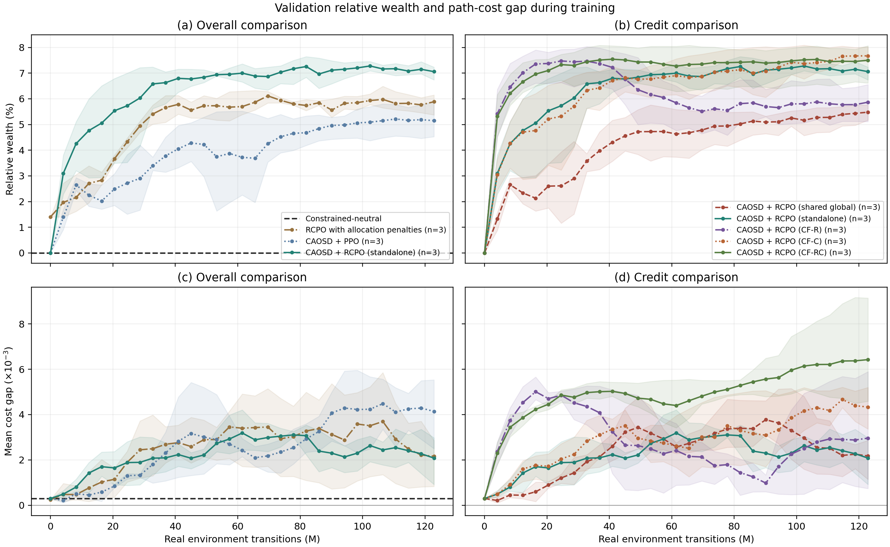

# V4.1 Paper Tables (best_return, seeds 0–2)

All test results use the same 100 held-out markets and the common drawdown rule.
Intervals resample the available training seeds and holdout anchors. Single-seed results reflect market uncertainty.

## Table 1. Overall Out-of-Sample Performance

| Method | Relative wealth (%) [95% CI] | Actual cumulative return (%) [95% CI] | Mean cost gap (×10⁻³) [95% CI] | Path feasibility (%) | MDD (%) | Turnover (%) | Allocation violation steps (%) |
| --- | ---: | ---: | ---: | ---: | ---: | ---: | ---: |
| Constrained-neutral | +0.00 [+0.00, +0.00] | 8.30 [5.82, 10.74] | +0.63 [+0.55, +0.69] | 15.00 | 15.69 | 0.00 | 0.00 |
| RCPO with allocation penalties | +7.44 [+5.64, +9.13] | 16.44 [13.00, 19.56] | +4.48 [+2.92, +6.79] | 28.00 | 16.15 | 6.83 | 59.80 |
| CAOSD + PPO | +7.07 [+5.21, +8.66] | 15.98 [11.54, 20.16] | +4.99 [+3.49, +6.47] | 32.00 | 15.89 | 3.16 | 0.00 |
| CAOSD + RCPO (shared global) | +7.32 [+5.66, +8.68] | 16.25 [12.14, 20.09] | +3.56 [+2.27, +4.82] | 34.00 | 15.58 | 4.12 | 0.00 |
| CAOSD + RCPO (standalone) | +8.09 [+5.83, +10.31] | 17.19 [13.99, 20.10] | +6.66 [+4.03, +10.58] | 20.67 | 16.98 | 1.94 | 0.00 |
| CAOSD + RCPO (CF-R) | +7.79 [+5.56, +10.64] | 16.91 [13.30, 20.07] | +7.35 [+2.78, +12.56] | 22.00 | 16.95 | 0.84 | 0.00 |
| CAOSD + RCPO (CF-C) | +8.28 [+5.75, +10.93] | 17.44 [14.12, 20.38] | +8.90 [+5.52, +13.70] | 17.00 | 17.54 | 1.91 | 0.00 |
| CAOSD + RCPO (CF-RC) | +7.76 [+5.51, +10.68] | 16.94 [13.30, 20.15] | +8.84 [+5.21, +13.66] | 18.33 | 17.38 | 1.06 | 0.00 |

## Table 2. Matched Credit Comparison Against Standalone

| Method | Δ relative wealth (pp) [95% CI] | Δ mean cost gap (×10⁻³) [95% CI] |
| --- | ---: | ---: |
| CAOSD + RCPO (shared global) | -0.77 [-3.05, +1.37] | -3.11 [-7.23, -0.06] |
| CAOSD + RCPO (standalone) | +0.00 [+0.00, +0.00] | +0.00 [+0.00, +0.00] |
| CAOSD + RCPO (CF-R) | -0.30 [-1.49, +0.76] | +0.69 [-3.69, +4.31] |
| CAOSD + RCPO (CF-C) | +0.19 [-0.37, +0.89] | +2.24 [+0.37, +5.41] |
| CAOSD + RCPO (CF-RC) | -0.32 [-1.51, +0.83] | +2.18 [-1.34, +5.18] |

## Table 3. Training and Deployment Costs

| Method | Training transitions (M) | Training hours | Peak RSS (GiB) | Decision latency (ms) | Relative time | Relative memory | Relative latency |
| --- | ---: | ---: | ---: | ---: | ---: | ---: | ---: |
| Constrained-neutral | 0.00 | N/A | N/A | 0.10 | N/A | N/A | 0.13 |
| RCPO with allocation penalties | 122.88 | 9.80 | 1.49 | 0.30 | 0.52 | 0.93 | 0.39 |
| CAOSD + PPO | 122.88 | 18.66 | 1.48 | 0.81 | 0.99 | 0.93 | 1.06 |
| CAOSD + RCPO (shared global) | 122.88 | 18.79 | 1.59 | 0.77 | 1.00 | 1.00 | 1.00 |
| CAOSD + RCPO (standalone) | 122.88 | 19.72 | 1.54 | 0.80 | 1.05 | 0.97 | 1.04 |
| CAOSD + RCPO (CF-R) | 122.88 | 28.13 | 1.97 | 1.05 | 1.50 | 1.24 | 1.37 |
| CAOSD + RCPO (CF-C) | 122.88 | 29.67 | 2.01 | 0.90 | 1.58 | 1.26 | 1.18 |
| CAOSD + RCPO (CF-RC) | 122.88 | 29.16 | 2.02 | 0.79 | 1.55 | 1.27 | 1.03 |

Training timing and memory ratios require matching hardware, timing boundaries, and interaction budgets.

## Figure 1. Validation Learning Curves

