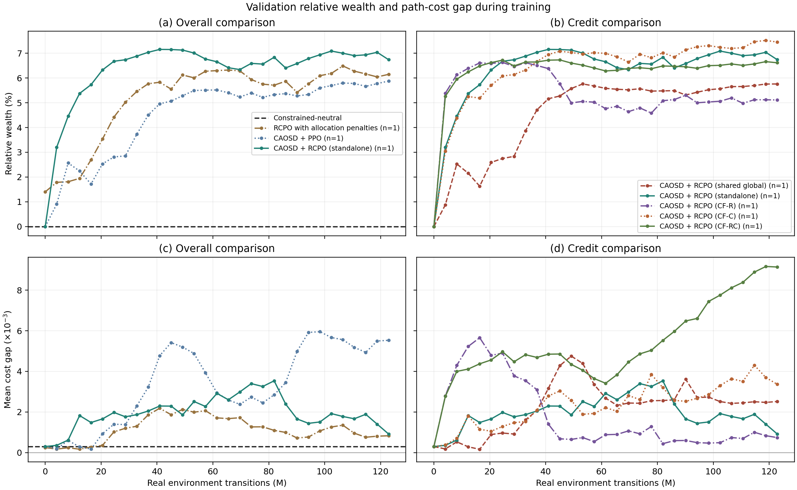

# V4.1 Paper Tables (best_return, seed 0)

All test results use the same 100 held-out markets and the common drawdown rule.
Intervals resample the available training seeds and holdout anchors. Single-seed results reflect market uncertainty.

## Table 1. Overall Out-of-Sample Performance

| Method | Relative wealth (%) [95% CI] | Actual cumulative return (%) [95% CI] | Mean cost gap (×10⁻³) [95% CI] | Path feasibility (%) | MDD (%) | Turnover (%) | Allocation violation steps (%) |
| --- | ---: | ---: | ---: | ---: | ---: | ---: | ---: |
| Constrained-neutral | +0.00 [+0.00, +0.00] | 8.30 [5.82, 10.74] | +0.63 [+0.55, +0.69] | 15.00 | 15.69 | 0.00 | 0.00 |
| RCPO with allocation penalties | +7.82 [+6.01, +9.82] | 16.85 [14.08, 19.33] | +4.65 [+3.16, +7.38] | 24.00 | 16.41 | 6.49 | 99.91 |
| CAOSD + PPO | +7.66 [+5.84, +9.07] | 16.56 [12.50, 20.28] | +4.79 [+3.49, +6.29] | 30.00 | 15.99 | 2.22 | 0.00 |
| CAOSD + RCPO (shared global) | +7.48 [+5.82, +8.73] | 16.36 [12.38, 19.96] | +4.48 [+3.33, +5.88] | 30.00 | 15.85 | 2.05 | 0.00 |
| CAOSD + RCPO (standalone) | +7.91 [+5.70, +10.12] | 17.05 [13.94, 19.81] | +6.42 [+4.37, +9.90] | 23.00 | 16.92 | 2.04 | 0.00 |
| CAOSD + RCPO (CF-R) | +6.49 [+5.05, +7.77] | 15.49 [11.87, 18.69] | +2.66 [+2.09, +3.25] | 32.00 | 15.45 | 0.95 | 0.00 |
| CAOSD + RCPO (CF-C) | +7.99 [+5.73, +10.26] | 17.14 [14.06, 19.92] | +6.97 [+4.85, +10.71] | 18.00 | 17.11 | 2.39 | 0.00 |
| CAOSD + RCPO (CF-RC) | +6.51 [+5.10, +7.75] | 15.67 [12.08, 18.98] | +5.30 [+4.04, +6.64] | 25.00 | 16.34 | 1.10 | 0.00 |

## Table 2. Matched Credit Comparison Against Standalone

| Method | Δ relative wealth (pp) [95% CI] | Δ mean cost gap (×10⁻³) [95% CI] |
| --- | ---: | ---: |
| CAOSD + RCPO (shared global) | -0.43 [-2.59, +1.73] | -1.94 [-4.16, -0.22] |
| CAOSD + RCPO (standalone) | +0.00 [+0.00, +0.00] | +0.00 [+0.00, +0.00] |
| CAOSD + RCPO (CF-R) | -1.42 [-2.79, -0.19] | -3.76 [-7.15, -1.71] |
| CAOSD + RCPO (CF-C) | +0.08 [-0.09, +0.24] | +0.55 [+0.31, +0.86] |
| CAOSD + RCPO (CF-RC) | -1.40 [-3.05, -0.05] | -1.12 [-4.75, +1.55] |

## Table 3. Training and Deployment Costs

| Method | Training transitions (M) | Training hours | Peak RSS (GiB) | Decision latency (ms) | Relative time | Relative memory | Relative latency |
| --- | ---: | ---: | ---: | ---: | ---: | ---: | ---: |
| Constrained-neutral | 0.00 | N/A | N/A | 0.10 | N/A | N/A | 0.13 |
| RCPO with allocation penalties | 122.88 | 9.81 | 1.49 | 0.38 | 0.52 | 0.94 | 0.50 |
| CAOSD + PPO | 122.88 | 18.78 | 1.48 | 0.79 | 1.00 | 0.93 | 1.04 |
| CAOSD + RCPO (shared global) | 122.88 | 18.79 | 1.59 | 0.76 | 1.00 | 1.00 | 1.00 |
| CAOSD + RCPO (standalone) | 122.88 | 19.14 | 1.53 | 0.77 | 1.02 | 0.96 | 1.01 |
| CAOSD + RCPO (CF-R) | 122.88 | 27.74 | 1.94 | 0.74 | 1.48 | 1.22 | 0.98 |
| CAOSD + RCPO (CF-C) | 122.88 | 29.48 | 2.01 | 0.78 | 1.57 | 1.27 | 1.03 |
| CAOSD + RCPO (CF-RC) | 122.88 | 30.10 | 2.03 | 0.78 | 1.60 | 1.27 | 1.03 |

Training timing and memory ratios require matching hardware, timing boundaries, and interaction budgets.

## Figure 1. Validation Learning Curves

