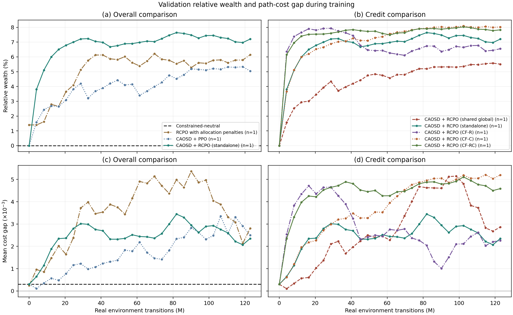

# V4.1 Paper Tables (best_return, seed 1)

All test results use the same 100 held-out markets and the common drawdown rule.
Intervals resample the available training seeds and holdout anchors. Single-seed results reflect market uncertainty.

## Table 1. Overall Out-of-Sample Performance

| Method | Relative wealth (%) [95% CI] | Actual cumulative return (%) [95% CI] | Mean cost gap (×10⁻³) [95% CI] | Path feasibility (%) | MDD (%) | Turnover (%) | Allocation violation steps (%) |
| --- | ---: | ---: | ---: | ---: | ---: | ---: | ---: |
| Constrained-neutral | +0.00 [+0.00, +0.00] | 8.30 [5.82, 10.74] | +0.63 [+0.55, +0.69] | 15.00 | 15.69 | 0.00 | 0.00 |
| RCPO with allocation penalties | +6.27 [+4.87, +7.53] | 15.27 [11.78, 18.55] | +3.13 [+2.35, +3.84] | 35.00 | 15.64 | 7.45 | 10.17 |
| CAOSD + PPO | +7.18 [+5.54, +8.71] | 16.08 [11.86, 20.13] | +3.72 [+3.14, +4.30] | 31.00 | 15.66 | 5.08 | 0.00 |
| CAOSD + RCPO (shared global) | +7.09 [+5.42, +8.89] | 16.08 [11.71, 20.44] | +4.03 [+3.71, +4.36] | 30.00 | 15.70 | 1.80 | 0.00 |
| CAOSD + RCPO (standalone) | +8.18 [+6.13, +10.22] | 17.23 [13.81, 20.45] | +5.18 [+3.35, +8.09] | 21.00 | 16.60 | 0.78 | 0.00 |
| CAOSD + RCPO (CF-R) | +8.38 [+5.71, +11.04] | 17.55 [14.11, 20.51] | +9.40 [+6.40, +13.94] | 17.00 | 17.63 | 0.61 | 0.00 |
| CAOSD + RCPO (CF-C) | +8.47 [+5.67, +11.27] | 17.66 [14.12, 20.67] | +10.65 [+7.32, +15.54] | 15.00 | 17.92 | 1.17 | 0.00 |
| CAOSD + RCPO (CF-RC) | +8.35 [+5.60, +11.11] | 17.53 [14.04, 20.50] | +10.11 [+6.96, +14.80] | 15.00 | 17.80 | 1.03 | 0.00 |

## Table 2. Matched Credit Comparison Against Standalone

| Method | Δ relative wealth (pp) [95% CI] | Δ mean cost gap (×10⁻³) [95% CI] |
| --- | ---: | ---: |
| CAOSD + RCPO (shared global) | -1.09 [-3.33, +1.15] | -1.15 [-4.15, +0.95] |
| CAOSD + RCPO (standalone) | +0.00 [+0.00, +0.00] | +0.00 [+0.00, +0.00] |
| CAOSD + RCPO (CF-R) | +0.20 [-0.94, +1.34] | +4.22 [+2.84, +5.95] |
| CAOSD + RCPO (CF-C) | +0.29 [-0.99, +1.58] | +5.48 [+3.76, +7.60] |
| CAOSD + RCPO (CF-RC) | +0.17 [-1.09, +1.44] | +4.94 [+3.37, +6.93] |

## Table 3. Training and Deployment Costs

| Method | Training transitions (M) | Training hours | Peak RSS (GiB) | Decision latency (ms) | Relative time | Relative memory | Relative latency |
| --- | ---: | ---: | ---: | ---: | ---: | ---: | ---: |
| Constrained-neutral | 0.00 | N/A | N/A | 0.10 | N/A | N/A | 0.13 |
| RCPO with allocation penalties | 122.88 | 9.86 | 1.49 | 0.26 | 0.52 | 0.93 | 0.35 |
| CAOSD + PPO | 122.88 | 18.55 | 1.49 | 0.86 | 0.97 | 0.93 | 1.17 |
| CAOSD + RCPO (shared global) | 122.88 | 19.14 | 1.59 | 0.74 | 1.00 | 1.00 | 1.00 |
| CAOSD + RCPO (standalone) | 122.88 | 18.94 | 1.53 | 0.78 | 0.99 | 0.96 | 1.06 |
| CAOSD + RCPO (CF-R) | 122.88 | 28.25 | 1.99 | 0.92 | 1.48 | 1.25 | 1.25 |
| CAOSD + RCPO (CF-C) | 122.88 | 29.77 | 2.01 | 0.99 | 1.56 | 1.26 | 1.35 |
| CAOSD + RCPO (CF-RC) | 122.88 | 28.94 | 2.03 | 0.81 | 1.51 | 1.27 | 1.10 |

Training timing and memory ratios require matching hardware, timing boundaries, and interaction budgets.

## Figure 1. Validation Learning Curves

