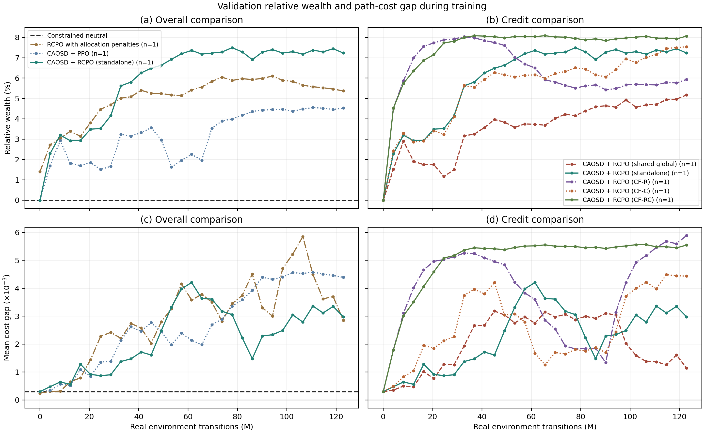

# V4.1 Paper Tables (best_return, seed 2)

All test results use the same 100 held-out markets and the common drawdown rule.
Intervals resample the available training seeds and holdout anchors. Single-seed results reflect market uncertainty.

## Table 1. Overall Out-of-Sample Performance

| Method | Relative wealth (%) [95% CI] | Actual cumulative return (%) [95% CI] | Mean cost gap (×10⁻³) [95% CI] | Path feasibility (%) | MDD (%) | Turnover (%) | Allocation violation steps (%) |
| --- | ---: | ---: | ---: | ---: | ---: | ---: | ---: |
| Constrained-neutral | +0.00 [+0.00, +0.00] | 8.30 [5.82, 10.74] | +0.63 [+0.55, +0.69] | 15.00 | 15.69 | 0.00 | 0.00 |
| RCPO with allocation penalties | +8.22 [+6.81, +9.61] | 17.19 [13.77, 20.75] | +5.66 [+3.74, +7.59] | 25.00 | 16.39 | 6.56 | 69.31 |
| CAOSD + PPO | +6.38 [+4.38, +8.37] | 15.29 [10.33, 20.25] | +6.45 [+5.83, +7.15] | 35.00 | 16.01 | 2.18 | 0.00 |
| CAOSD + RCPO (shared global) | +7.39 [+5.92, +8.55] | 16.32 [12.46, 19.89] | +2.16 [+1.50, +3.10] | 42.00 | 15.18 | 8.52 | 0.00 |
| CAOSD + RCPO (standalone) | +8.17 [+5.65, +10.69] | 17.29 [14.00, 20.23] | +8.39 [+5.87, +12.42] | 18.00 | 17.42 | 2.99 | 0.00 |
| CAOSD + RCPO (CF-R) | +8.50 [+5.85, +11.18] | 17.68 [14.34, 20.64] | +10.00 [+7.06, +14.85] | 17.00 | 17.78 | 0.96 | 0.00 |
| CAOSD + RCPO (CF-C) | +8.36 [+5.87, +10.85] | 17.52 [14.27, 20.47] | +9.08 [+6.28, +13.68] | 18.00 | 17.58 | 2.18 | 0.00 |
| CAOSD + RCPO (CF-RC) | +8.43 [+5.59, +11.28] | 17.61 [14.05, 20.64] | +11.10 [+7.62, +16.18] | 15.00 | 18.00 | 1.03 | 0.00 |

## Table 2. Matched Credit Comparison Against Standalone

| Method | Δ relative wealth (pp) [95% CI] | Δ mean cost gap (×10⁻³) [95% CI] |
| --- | ---: | ---: |
| CAOSD + RCPO (shared global) | -0.78 [-3.24, +1.68] | -6.23 [-9.43, -3.94] |
| CAOSD + RCPO (standalone) | +0.00 [+0.00, +0.00] | +0.00 [+0.00, +0.00] |
| CAOSD + RCPO (CF-R) | +0.33 [+0.13, +0.56] | +1.61 [+1.06, +2.50] |
| CAOSD + RCPO (CF-C) | +0.19 [+0.06, +0.31] | +0.69 [+0.31, +1.31] |
| CAOSD + RCPO (CF-RC) | +0.26 [-0.13, +0.65] | +2.71 [+1.75, +3.76] |

## Table 3. Training and Deployment Costs

| Method | Training transitions (M) | Training hours | Peak RSS (GiB) | Decision latency (ms) | Relative time | Relative memory | Relative latency |
| --- | ---: | ---: | ---: | ---: | ---: | ---: | ---: |
| Constrained-neutral | 0.00 | N/A | N/A | 0.10 | N/A | N/A | 0.12 |
| RCPO with allocation penalties | 122.88 | 9.71 | 1.48 | 0.27 | 0.53 | 0.93 | 0.33 |
| CAOSD + PPO | 122.88 | 18.65 | 1.48 | 0.79 | 1.01 | 0.93 | 0.98 |
| CAOSD + RCPO (shared global) | 122.88 | 18.45 | 1.60 | 0.80 | 1.00 | 1.00 | 1.00 |
| CAOSD + RCPO (standalone) | 122.88 | 21.06 | 1.56 | 0.85 | 1.14 | 0.98 | 1.05 |
| CAOSD + RCPO (CF-R) | 122.88 | 28.39 | 1.99 | 1.49 | 1.54 | 1.24 | 1.85 |
| CAOSD + RCPO (CF-C) | 122.88 | 29.77 | 2.01 | 0.93 | 1.61 | 1.26 | 1.16 |
| CAOSD + RCPO (CF-RC) | 122.88 | 28.43 | 2.02 | 0.78 | 1.54 | 1.27 | 0.97 |

Training timing and memory ratios require matching hardware, timing boundaries, and interaction budgets.

## Figure 1. Validation Learning Curves

